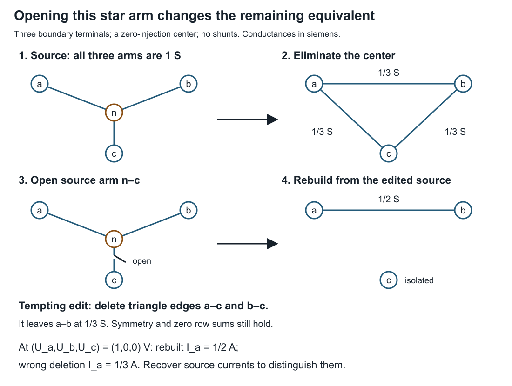
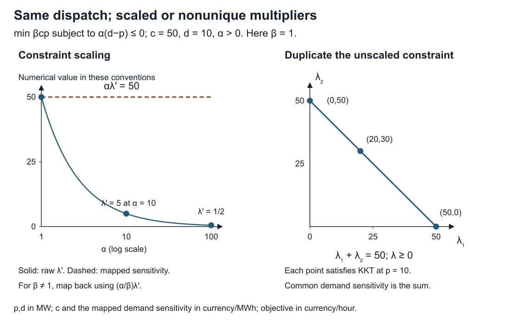

# [Building and changing a model you can check](@id building-and-changing-models)

**Page status:** three exact executable teaching witnesses with deliberate
failures and transfer exercises; not a production importer, incremental network
compiler, or OPF price validator.

A colleague sends a network file, asks for one outage, and wants the marginal
cost of serving more demand. Each request looks routine. Each crosses a boundary
where software can change the mathematical problem without producing an error.
This chapter works through those boundaries using three small models, so every
expected result can be derived before running code.

The [assembly lesson](@ref source-to-canonical-model) supplies the method for
constructing and checking equations. Here the task is to keep their meaning
intact during import, modification, and interpretation. Run all three examples
from the repository root; they require only standard-library Python and write
no files:

```sh
python3 experiments/lessons/practical_model_checks.py
python3 experiments/lessons/practical_model_checks.py --check
```

## Import meaning, not just numbers

Suppose a source record contains a branch rating of zero. Predict the result
of testing a 10 MVA transfer: should it pass, fail, or remain undecided?

There is no answer until the field convention is known. In MATPOWER's version-2
case format, `RATE_A=0` specifies an unlimited rating. `TAP=0` indicates a line,
whose ratio is mathematically unity, rather than a transformer of zero ratio.
These are documented encodings, not defects [MATPOWERCaseFormat](@cite).

The lesson's small internal rating type separates four states:

| Internal state | Meaning in this example | Result at 10 MVA |
| --- | --- | --- |
| finite, 0 MVA | impose a zero magnitude bound | failed |
| unbounded | impose no bound from this rating field | passed |
| unknown | no rating value or explicit unbounded declaration available | indeterminate |
| not applicable | this particular rating check does not apply | not applicable |

These are outcomes of one rating check, not a feasibility verdict on the network.
The source format still requires its fields; representing an absent field as
unknown is a way to retain incomplete input for diagnosis, not to declare it a
valid MATPOWER case.

The faulty adapter copies `RATE_A=0` into an internal finite zero bound. It
accepts the file, retains the number and units, and rejects the transfer. The
correct field adapter decodes the sentinel and passes this particular check.
Neither result depends on solving power flow.

A numerical round trip does not expose the faulty adapter: a mistaken reader
and writer can reproduce the same zero while imposing the wrong constraint in
between. Test the decoded *behavior* against the source convention. Claim
`PRACTICE-IMPORT-001` records this narrow counterexample.

The reverse conversion also has limits. A true finite zero bound cannot be
written as `RATE_A=0` without changing its meaning. The lesson refuses to encode
that state, an unknown rating, or a not-applicable state into this single field.
A production exporter needs an explicitly supported alternative representation
or a clear refusal. It must not silently replace them with unlimited capacity.

For `TAP`, preserve both the effective ratio and the source kind: a line encoded
by zero and a unity-ratio transformer encoded by one can share a ratio without
having identical equipment semantics. Other transformer fields and conventions
are outside this field-level exercise.

**Change the input.** Set `RATE_A=10`, then test transfers of 10 and 11 MVA.
Remove the rating field rather than setting it to zero. Explain the three
results before executing the checks. The finite rating passes at its bound,
fails above it, and the missing field remains unknown. No inference has supplied
an equipment rating.

## Rebuild after an edit before attempting reuse

Consider three resistive arms connecting boundary terminals ``a,b,c`` to an
internal node ``n``. All three conductances are 1 S. There is no current
injection or shunt at ``n``. Currents are positive from each boundary terminal
toward the center.

For nonnegative arm conductances ``g_a,g_b,g_c`` with positive sum ``s``, KCL gives

```math
U_n=\frac{g_aU_a+g_bU_b+g_cU_c}{s},\qquad
I_k=g_k(U_k-U_n),\qquad s=g_a+g_b+g_c.
```

Eliminating the center therefore gives the exact boundary operator

```math
\mathbf K=\operatorname{diag}(g_a,g_b,g_c)
 -\frac{1}{s}\mathbf g\mathbf g^{\mathsf T},\qquad
\mathbf g=(g_a,g_b,g_c)^{\mathsf T}.
```

For the three equal arms this is a triangle of conductance ``1/3`` S on each
edge. Predict the new boundary operator when the *source arm* ``n-c`` is opened.

Opening that arm sets ``g_c=0``. It leaves a series path from ``a`` to ``b``
with conductance ``1/2`` S, and an isolated terminal ``c``:

```math
\mathbf K_{\mathrm{open}}=
\begin{bmatrix}
1/2&-1/2&0\\
-1/2&1/2&0\\
0&0&0
\end{bmatrix}\ \mathrm S.
```



A tempting update deletes the two triangle edges incident to ``c``. That leaves
conductance ``1/3`` S between ``a`` and ``b``. The updated graph has the expected
isolated terminal, a symmetric operator, and zero row sums, yet it is wrong.
At boundary voltages ``(1,0,0)`` V, the correct injection at ``a`` is ``1/2`` A;
the faulty update gives ``1/3`` A. Both boundary-current vectors sum to zero,
so an aggregate current-balance check cannot discriminate them.

Recover ``U_n=1/2`` V from the edited source, then evaluate the original arm
laws to expose the mismatch. Claim `PRACTICE-UPDATE-001` concerns this specific
failed update. It does not assert that reductions can never be updated
incrementally: an update using sufficient source information can be correct.

The code keeps the source conductances with each compiled operator. Using the
old operator with changed conductances raises a stale-reduction error. Rebuilding
from the changed source restores agreement. The deliberately faulty update even
attaches the new source identity to the wrong matrix: correct metadata alone
does not establish that the equations were updated correctly.

For each tested source, the checker compares the matrix with a separate arm-law
evaluation on all three boundary basis vectors. Because both maps are linear,
equality on that basis establishes equality throughout their boundary-voltage
space in exact arithmetic. This conclusion relies on the declared resistive
model, linearity and recovered center equation; it does not authenticate the
conductance data or establish a general nonlinear update method.

**Change the input.** After opening ``n-c``, change ``g_b`` to 2 S. Derive the
remaining series conductance before rebuilding. It is ``2/3`` S. Then open all
three arms. The displayed inverse formula is inapplicable because ``s=0``;
the center voltage is undetermined, although the boundary current map can still
be represented as zero. The lesson rejects that input rather than dividing by
zero or claiming that the circuit cannot be represented at all.

## Recover the meaning of a multiplier

Use a separate scalar dispatch model to isolate the interpretation issue. Let
``p`` be supplied power in MW, ``d>0`` a demand requirement, and ``c>0`` a constant
cost in currency/MWh. There is no upper capacity limit in this example:

```math
\min_{p\in\mathbb R} cp\quad\text{subject to}\quad d-p\le0.
```

The unique optimum is ``p^*=d`` and the cost rate is ``cd`` in currency/hour.
Using the displayed inequality convention, the Lagrangian is
``cp+\lambda(d-p)``. Stationarity gives ``\lambda=c``.

Now multiply the constraint by ``\alpha>0`` and the objective by ``\beta>0``.
These are explicit positive numerical scaling factors:

```math
L'=\beta cp+\lambda'\alpha(d-p),\qquad
\lambda'=\frac{\beta c}{\alpha}.
```

Dispatch is unchanged, but the raw multiplier is not. The derivative of the
*unscaled physical cost rate* ``C(d)=cd`` with respect to physical demand is

```math
C'(d)=c=\frac{\alpha}{\beta}\lambda'.
```

For ``c=50`` currency/MWh and ``d=10`` MW, changing ``\alpha`` from 1 to 100
while retaining ``\beta=1`` changes the raw multiplier from 50 to ``1/2``.
Both cases supply 10 MW at 500 currency/hour; both have marginal physical cost
50 currency/MWh. Reporting the raw ``1/2`` as that price would be an
interpretation error.

This is a direct perturbation calculation, consistent with the duality and
sensitivity treatment in [BoydVandenberghe2004](@cite). It fixes the inequality
sign and objective convention explicitly; a solver interface using another
convention requires its own mapping. It is not an AC-OPF locational-price
certificate. Claim `PRACTICE-DUAL-001` records the scalar scaling and
nonuniqueness example.

Duplicate the original unscaled constraint. Stationarity now requires
``\lambda_1+\lambda_2=c`` with both multipliers nonnegative. The allocations
``(50,0)``, ``(0,50)`` and ``(20,30)`` all satisfy the KKT conditions at the same
optimum. Individual constraint multipliers are not unique. If demand changes in
both copies together, its cost sensitivity is their sum. Changing only one copy
is a different perturbation question.



The left panel plots the analytical multiplier against ``\alpha`` on a
logarithmic horizontal axis with ``\beta=1``. The right panel concerns the
duplicated, unscaled model. Its entire segment satisfies KKT at ``p=d``;
the three marked points are examples, not three unique solver outputs.

**Change the scaling.** Set ``\alpha=100`` and ``\beta=1/1000``. The raw
multiplier becomes ``1/2000``; mapping back still gives 50 currency/MWh. Check
this by increasing demand by ``1/10`` MW: the physical cost rate increases by
5 currency/hour. A negative constraint scale would reverse the inequality
unless the formulation were changed; it is outside the stated rule.

## [Small resistance can select a current that an ideal switch does not](@id vanishing-impedance-current-selection)

**Predict before simplifying.** Two fixed, uncoupled, series-only resistors
connect the same two terminals. They carry a prescribed total current of 12 A.
Let ``R_1=\varepsilon`` Ω and ``R_2=2\varepsilon`` Ω with dimensionless
``\varepsilon>0``. The first member is limited to 7 A and the second to 10 A.
If the voltage drop becomes arbitrarily small, may both members be replaced
by ideal shorts without changing their current-limit behaviour?

Write the member equations and KCL before taking a limit:

```math
\Delta V=R_1I_1=R_2I_2,\qquad I_1+I_2=I.
```

For ``R_1=a\varepsilon`` Ω and ``R_2=b\varepsilon`` Ω with fixed positive
dimensionless ``a,b``, direct elimination gives

```math
I_1=\frac{b}{a+b}I,\qquad I_2=\frac{a}{a+b}I,\qquad
\Delta V=\varepsilon\frac{ab}{a+b}I\ \Omega.
```

In the 1:2 example the member currents are 8 A and 4 A for *every* positive
``\varepsilon``. At ``\varepsilon=10^{-3}``, the voltage drop is 0.008 V and
the loss is 0.096 W. Decreasing ``\varepsilon`` by a factor of 1000 decreases
both drop and loss by that factor, while the 8 A member current still violates
its 7 A limit. Current and rating agreement cannot be inferred from a small
voltage discrepancy.

### Taking a limit and replacing the equations

Set both resistances to exactly zero in the member equations instead. They now
require only

```math
\Delta V=0,\qquad I_1+I_2=12\ \mathrm A.
```

Every pair ``(t,12-t)`` satisfies these equations. The perturbation
``(\delta I_1,\delta I_2,\delta\Delta V)=(q,-q,0)`` is a free circulating-current
mode. The ideal equations retain neither ``a`` nor ``b``, so they cannot select
the finite model's limiting split. Additional control, circuit constraints or a
stated selection rule could do so, but would be additional model information.

Swap the finite resistance ratios to 2:1. The currents become 4 A and 8 A,
which satisfy the same two ratings. Yet the voltage drop and total loss are
identical to the 1:2 case at every positive ``\varepsilon``, and both families
have the same zero-drop limit. Claim `PRACTICE-SHORT-001` records this directly
derived counterexample. It disproves a general current-preservation guarantee;
it is not a universal convergence theorem for nonlinear networks, complex
impedances, or switching dynamics.

### Check the feasible total current, not just one voltage

Allow ``I\ge0`` to vary and impose only the two member current-magnitude limits
``L_1,L_2``. The finite positive-resistance family has

```math
I_{\max}^{\mathrm{finite}}
=\min\!\left(L_1\frac{a+b}{b},L_2\frac{a+b}{a}\right).
```

For ``a=1,b=2,L_1=7`` A and ``L_2=10`` A this is 10.5 A. The ideal-short model
can choose its split and reaches ``L_1+L_2=17`` A with ``(I_1,I_2)=(7,10)`` A.
No larger total is possible because
``I=|I_1+I_2|\le |I_1|+|I_2|\le L_1+L_2`` for ``I\ge0``.
At the original 12 A demand it can choose ``(6,6)`` A and pass both limits,
even though the finite 1:2 family cannot. These maxima follow analytically from
the stated constraints; no optimizer or claim of AC-OPF global optimality is
involved.

```sh
python3 experiments/lessons/vanishing_impedance.py --check
python3 experiments/lessons/vanishing_impedance.py --epsilon 1/1000000
python3 experiments/lessons/vanishing_impedance.py --ratio1 2 --ratio2 1
```

The script uses exact rational arithmetic. It checks current division, loss,
reverse flow, the ideal free-current family, the rating boundary and a transfer
case. It rejects zero as an input to the *finite-resistance* formula instead of
silently choosing one ideal current split.

**Transfer exercise.** Use ``R_1=\varepsilon`` Ω and ``R_2=3\varepsilon`` Ω
with the same 12 A demand and 7 A / 10 A limits. Predict the split and the
finite-model maximum total current. Does the ideal-short maximum change?
**Check your reasoning:** the finite split is 9 A / 3 A, with maximum total
current ``28/3`` A; the first limit controls. The ideal equations have forgotten
the resistance ratio and still admit 17 A. Compare the current observations
and retained member constraints, not just bus voltages.

The [transformer port lesson](@ref ideal-transformer-port-lesson) retains finite
leakage when changing representation. Setting that leakage to zero would be a
different transformation, just as it is here. The earlier
[parallel-member lesson](@ref first-failure-parallel-branches) explains why the
source member observations and their limits must remain recoverable. None of
these examples prescribes an epsilon for real equipment or establishes a
safe physical switching approximation.

## [A parameter at zero is still part of a model family](@id parameter-reuse-lesson)

**Predict.** A 10 V source supplies a conductance with current law

```math
I(\theta,V)=\theta gV,\qquad g=0.1\ {\mathrm{S}},\quad 0\le\theta\le2.
```

At ``\theta=0`` its current is zero. A compiler deletes the term and keeps the
compiled model for later values of ``\theta``. Will a successful solve at
``\theta=2`` recover the intended 2 A current?

No. Deleting the term agrees with the family at the initial state but replaces
it by ``\widetilde I(\theta,V)=0`` at every later state. At fixed 10 V, the
residual against the **requested** law is
``r_I=\widetilde I-\theta gV=-\theta`` A. The model that was actually emitted can
be solved perfectly and still answer the wrong question. This is the finite
counterexample in claim `PRACTICE-REUSE-001`.

| Parameter ``\theta`` | Fresh or correctly reused current | Deleted-term current | Deleted-term residual |
|:--|--:|--:|--:|
| 0 | 0 A | 0 A | 0 A |
| 1 | 1 A | 0 A | −1 A |
| 0, revisited | 0 A | 0 A | 0 A |
| 2 | 2 A | 0 A | −2 A |
| 0.5 | 0.5 A | 0 A | −0.5 A |

The order matters to the experiment: it exercises entry into zero and return
from zero, rather than testing isolated positive values only. A literal
coefficient known to be identically zero over the declared family can be
removed; a symbolic parameter whose **current value** is zero cannot be removed
on that evidence alone. Nor does a zero current at ``V=0`` establish that the
coefficient is absent. Retain the dependency that the next state will need.

### Three failures with different remedies

1. **Lost symbolic dependence.** The intended term never survives construction.
   Refreshing the optimizer cannot restore it. Repair the builder and rebuild.
2. **Stale numerical evaluation.** The expression still contains the parameter,
   but an optimizer/evaluator reuses values from an earlier state. Follow the
   package's supported reset/re-solve workflow and check the updated equations.
3. **An unrepresented structural edit.** Adding a second physical branch with
   conductance 0.05 S changes the intended current at ``\theta=2`` to 3 A. The
   old one-branch model still gives 2 A. Rebuild this example with both branches;
   changing the source list does not add its equations to an existing model.

A topology state **already represented** by a supported parameter is a different
case from adding a branch outside the compiled structure. A numerical zero may
change the active matrix support without requiring a different symbolic model.
Name the intended family and the update API before deciding whether an edit is
structural. Do not infer reuse safety from a visually unchanged graph.

### Compare from scratch, then test the requested law

The package companion constructs a custom conductance through the public staged
injection API in native SI units. It compares fresh builds with a reused context
updated through `resolve_opf!`, at every value in the table. It evaluates source
current minus ``\theta\sum_k g_kV`` independently from the emitted constraints,
with a ``10^{-7}`` A current tolerance and ``10^{-8}`` V source-voltage tolerance.
The deliberately deleted branch and the unrepresented second branch are rejected
by this same check. Agreement between fresh and reused builders alone would not
exclude a mistake shared by both builders.

```sh
python3 experiments/lessons/parameter_reuse.py --check
python3 scripts/check_bmopf_integration.py --bmopf-root ../BMOPFTools.jl
```

The integration runner writes `parameter-reuse.json` alongside the other lesson
results, tied to the unchanged published package pin and environment. Each row
records requested inputs, their fingerprint, parameter and construction hashes,
solver/primal status and physical residuals when an accepted-status candidate
exists. Equal hashes identify encoded inputs or construction; they do not prove
that a cache is fresh or that the scientific model is adequate. The Python
companion uses exact rational arithmetic and needs no solver.

A separate dimensionless cache probe uses ``x=p\exp(y)``, ``y=1``, and the
sequence ``p=1,0,2``. In the recorded Julia 1.12.6 / JuMP 1.32.1 / MOI 1.54.0 /
Ipopt.jl 1.16.0 run, the last unrefreshed solve reports `LOCALLY_SOLVED` but
returns ``x=0``: its independently evaluated residual is ``-2e\approx-5.4366``.
This is an observation for that stack and initialization. The regression gate
requires the supported reuse path to pass; it does not require future optimizer
versions to reproduce the stale-cache failure. The package owns the
[reset workflow and its supported domain](https://github.com/frederikgeth/BMOPFTools.jl/blob/97c274946091859b7d9b0e822c96f1e7f9f50c7e/docs/src/differentiable_extensions.md#L515).
Reloading does not promise retained factorizations, automatic warm starts or a
speed improvement. This custom linear circuit does not certify every native
nonlinear load provider or arbitrary parameterized OPF.

### Keep failed scenarios in the study

Add an upper bound of 1.5 A to the source current. At 10 V, the sequence
``\theta=1,2,0.5`` requires 1 A, 2 A and 0.5 A. The middle case is infeasible by
the two incompatible requirements ``I=2`` A and ``I\le1.5`` A. That conclusion
comes from the scalar equations, not from a general interpretation of a local
solver's infeasibility status.

The companion records the failed solve with no accepted current and a null
residual, then checks successful recovery at 0.5. It does not copy the previous
1 A result into the failed row, nor replace missing evidence by zero. A solver
may expose an infeasible iterate; that is diagnostic data rather than a valid
operating point. Status gating must precede extraction and physical validation.

**Transfer exercise.** Use ``g=0.2`` S, ``V=-5`` V and ``\theta=2``. What is the
current, and what would the deleted-term residual be? **Check your reasoning:**
``I=-2`` A and ``r_I=+2`` A. Reversing the voltage does not remove parameter
dependence. If the thermal limit is ``|I|\le1.5`` A, the state violates it even
though a signed upper bound ``I\le1.5`` A would pass. Preserve the meaning of the
limit as well as its numeric value.

## Organize the implementation around these checks

Keep source records separate from generated equations and results. A source
record identifies the equipment and its declared state. A compiled object
identifies the assumptions and source values used to construct it. A result
identifies the compiled object that was actually solved. A change to one does
not automatically update the others.

Start with a rebuild path whose output can be checked. Add reuse only after
specifying which changes preserve the cached object and which invalidate it.
For a larger network, an invalidation key may need terminal ordering, topology,
device parameters, operating point, formulation options and implementation
version. The three conductances are sufficient only for this fixed star API.

This is the question of *from-scratch consistency* in incremental computation:
does reusing work after an input change agree with recomputing the specified
computation [HammerEtAl2015](@cite)? For numerical solvers, compare mapped
observations and declared tolerances rather than demanding identical iterates.

Likewise, translating a source network into equations resembles a compiler
pass. Translation validation checks a particular source/target pair, with its
own checker and soundness obligations [TristanLeroy2008](@cite). The book's
finite witnesses use that idea; they are not formally verified compilers.
Sharing a primitive formula or mistaken input between builder and checker can
leave a common error undetected.

Use the following sequence when a colleague reports a disagreement:

1. **Identify the question.** Is the disagreement about a field, equation,
   feasible state, recovered observation, objective, or sensitivity?
2. **Keep the source.** Record the exact input and edit; do not repair the only
   copy of the failing case in place.
3. **Rebuild and recover.** Compare fresh and reused computations, then evaluate
   the original quantities needed by the study.
4. **Change a diagnostic input.** Use an independent boundary excitation, a
   limit-crossing value, or a specified perturbation. A test that both wrong and
   right models pass does not resolve their disagreement.
5. **Minimize the failure.** Remove unnecessary equipment while retaining the
   assumptions and failure criterion; keep that case as a regression test.

## Submit a small, reviewable correction

For one example, submit the original input, the proposed edit, your predicted
result, the faulty result, and the check that distinguishes them. State a
plausible test that would *not* detect the problem. Finally, state what your
correction does not establish.

A satisfactory import correction distinguishes the explicit sentinel from
missing data and refuses an unrepresentable export. A satisfactory update
correction recovers the edited source currents, including the asymmetric
transfer case. A satisfactory dual correction names the perturbation, scaling
and sign convention and handles the duplicated constraints without inventing
unique individual prices. These are separate scientific obligations even when
all three implementations return numbers successfully.
