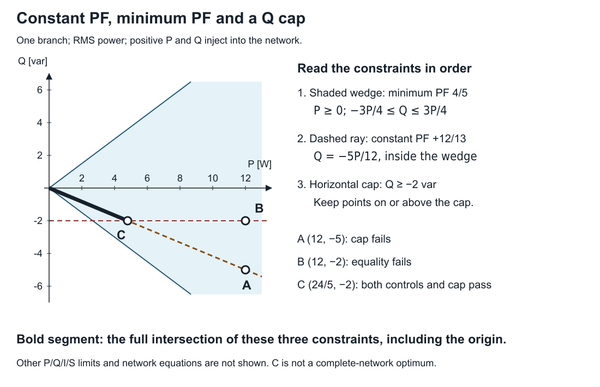
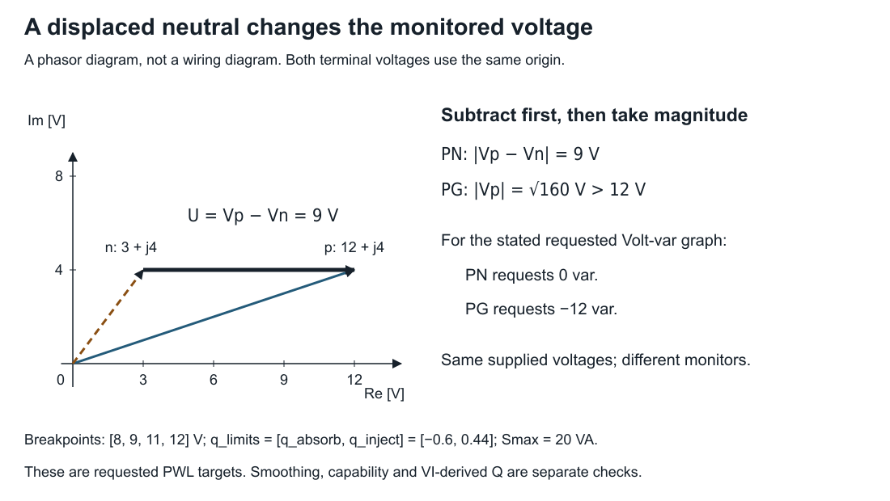

# [Check a converter operating point by hand](@id checking-ibr-operating-point)

**Page status:** self-checked arithmetic tutorial for one supplied RMS operating point; no network solve or physical controller validation.

A converter can satisfy its power-factor law and still violate a capability
limit. Changing Q to meet the limit can then break the law. This tutorial makes
that conflict visible in the P–Q plane, starting from voltage and current rather
than reported power. It then changes the voltage monitor without changing the
supplied phasors.

You need complex conjugation and a linear inequality. The calculation runs with
Python alone; the package-specific applicability rules remain in
[IBR control applicability](@ref ibr-pf-control-audit).

## 1. Recover power from the supplied phasors

Use a single ordered phase–neutral pair with RMS terminal voltages relative to
the same earth/frame origin:

```math
V_p=12+\mathrm j4\ \mathrm V,\qquad
V_n=3+\mathrm j4\ \mathrm V,\qquad
U=V_p-V_n=9\ \mathrm V.
```

Define I as the current injected by the converter at p, with −I injected at n.
Positive P and Q denote injection into the network. Supply

```math
I=\frac43+\mathrm j\frac59\ \mathrm A.
```

**Predict:** is the reactive injection positive or negative?

Conjugating the current gives

```math
S=U\overline I
 =9\left(\frac43-\mathrm j\frac59\right)
 =12-\mathrm j5\ \mathrm{VA}.
```

Thus P = 12 W and Q = −5 var. Call this point **A**. Its apparent power is
13 VA, so its PF magnitude is 12/13.

**Check the sign convention before you transfer a number.** In the signed
constant-PF convention used here, target f = +12/13 requires negative Q
(absorption) when P is positive. OpenDSS generator and PV elements use the
opposite sign: a positive `pf` there gives kvar the same sign as kW. Copying
`pf=0.923` (≈12/13) between the two conventions therefore reverses the requested
reactive power. The equation below is the definition for this exercise.

## 2. Intersect the laws; do not clip a point into compliance

Take constant target f = +12/13, generation-only minimum m = 4/5, and a lower
reactive injection bound Q ≥ −2 var. The complementary coefficients are
√(1−f²) = 5/13 and √(1−m²) = 3/5, so the three obligations are

```math
\begin{aligned}
\text{Constant PF:}\quad &\frac{12}{13} Q+\frac5{13} P=0,\\
\text{Minimum PF:}\quad &P\ge0,\quad -\frac34P\le Q\le\frac34P,\\
\text{Capability:}\quad &Q\ge-2\ \mathrm{var}.
\end{aligned}
```



*The bold segment satisfies all three declared constraints. A lies below the
Q cap; B lies off the constant-PF ray; C is their intersection. The shaded
minimum-PF wedge alone admits both signs of Q. Because f > m, the constant-PF
ray lies strictly inside the wedge: the two laws are different constraints,
even though both are called "power factor". No other capability limit or
network equation is included in this picture. The shaded wedge is truncated
at the plot edge; there is no other P or Q bound.*

At A, constant and minimum PF pass, but Q is 3 var below the lower bound. A
is also well inside the minimum-PF wedge (|Q| = 5 ≤ 9), so a small numerical
tolerance would not change that verdict. Suppose we replace Q by −2 var while
retaining P = 12 W. This gives **B**. Its constant-PF weighted residual becomes

```math
\left|\frac{12}{13}(-2)+\frac5{13}(12)\right|=\frac{36}{13}\ \mathrm{VA}.
```

B satisfies the minimum envelope and Q cap, but fails constant PF. Clipping Q
has changed which obligation fails. Note that B still satisfies *minimum* PF:
a check of the minimum envelope alone would accept the clipped point.

To retain constant PF, follow its line Q = −5P/12 to the cap. Solving
−5P/12 = −2 gives **C**: P = 24/5 W, Q = −2 var. More generally, all points on
the bold segment satisfy these three constraints:

```math
0\le P\le\frac{24}5\ \mathrm W,\qquad Q=-\frac5{12}P.
```

C is the largest P in this local intersection. A feeder equation, another
device limit or an objective can change the network's admissible or selected
point. The diagram does not establish a network optimum. At the origin the
weighted laws pass, but the PF quotient is undefined.

The [control chapter](@ref ibr-pf-control-audit)'s package example uses
f = m = 0.8 instead. There the constant-PF ray is the wedge's lower edge, so
every point on it sits exactly on the minimum-PF boundary. Rounding or a
finite residual tolerance can then decide the minimum-PF verdict; the chapter
explains why a fixed weighted tolerance does not certify a PF ratio.

## 3. Change the monitor, keeping the phasors fixed

A voltage-dependent controller must say which voltage it measures. For the
same terminal phasors, phase-to-neutral (PN) and phase-to-ground (PG) give

```math
U_{\mathrm{PN}}=|V_p-V_n|=9\ \mathrm V,\qquad
U_{\mathrm{PG}}=|V_p|=\sqrt{160}\ \mathrm V>12\ \mathrm V.
```

Subtracting phasors before taking the magnitude matters. Subtracting their
separate magnitudes would not give PN voltage.



*The horizontal arrow is the phase–neutral difference. The diagonal phase
vector starts at the earth/frame origin. PN and PG are different observations
of the same supplied state, not two solutions of the circuit.*

For a separate Volt-var exercise, use the chapter's requested piecewise-linear
(PWL) graph: voltage breakpoints [8,9,11,12] V, branch rating 20 VA and
reactive fractions `q_limits=[q_absorb,q_inject]=[−0.6,0.44]`. That field lists
absorption first; it is not in breakpoint order. The graph injects
0.44 × 20 = 8.8 var below 8 V and absorbs 0.6 × 20 = 12 var above 12 V. PN is
at the start of the zero band and requests Q = 0. PG exceeds the last
breakpoint and requests Q = −12 var. The VI-derived injection at A is still
−5 var; changing the monitor changes the request, not that observation.

This is an alternative control example, not a PF/droop mixture. These are
requested PWL targets; the [declared smoothed model](@ref ibr-volt-var-audit)
has its own target and residual. A target alone does not show that capability,
minimum PF or the network can accommodate it.

## Run it, then change one input

From the repository root, using Python 3.11 or later:

```sh
python3 experiments/lessons/ibr_operating_point.py
python3 experiments/lessons/ibr_operating_point.py --check
python3 experiments/lessons/ibr_operating_point.py --q-min=-1
```

The default run prints A = (12,−5), B = (12,−2), C = (24/5,−2), with separate
constant-PF, generation, minimum-envelope and Q-cap residuals. Nonzero residuals
identify failures of these exact equations. The script uses rational arithmetic
and writes no files. Its eight checks also cover the ray lying inside the
wedge, reference reversal, a common terminal-voltage shift, absorption and a
per-phase violation hidden by totals.

Before running the last command, predict where C moves. Then explain why A's
power is unchanged: its authored voltage and current were not changed.

**Answer:** Q ≥ −1 intersects the ray at P = 12/5 W, Q = −1 var. The admissible
segment shortens. A still has P = 12 W and Q = −5 var, so its Q-cap violation
grows to 4 var. The command changes a bound, not the supplied point or a solve.

**Transfer exercise:** now consider three per-phase minimum-PF declarations
with m = 4/5 and powers P = [1,10,10] W, Q = [3,0,0] var. Does an aggregate
PF check establish all three declarations?

**Answer:** aggregate P = 21 W and Q = 3 var give PF magnitude
``21/\sqrt{21^2+3^2}>4/5``. The first phase nevertheless has upper weighted
excess ``(4/5)3-(3/5)1=9/5`` VA. Check the declared branch scope before summing
powers. The [control chapter](@ref ibr-pf-control-audit) carries this distinction
into topology applicability, incomplete observations and finite tolerances.
