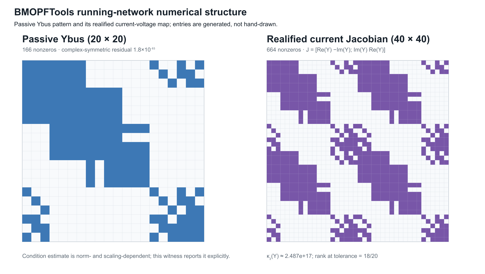
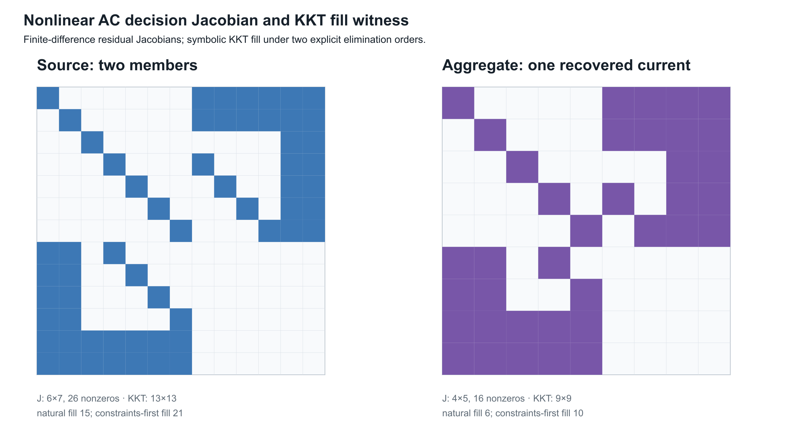

# [Numerical consequences of representation and reduction](@id numerical-consequences)

**Page status:** generated structural, linearized, symbolic KKT, and
package-level solver-diagnostics crosswalk witnesses; solver-internal
nonlinear exports remain future work.

## A graph choice is also a numerical choice

Two representations can describe the same declared electrical behaviour while
producing very different numerical problems. A quotient may reduce the number
of variables but worsen scaling; a Kron reduction may preserve a boundary
relation but introduce dense couplings; a factor model may expose physical
structure while a bus--branch compiler produces a smaller, more familiar
Jacobian. These are computational consequences, not afterthoughts.

The relevant comparison is therefore not only

```math
\text{same terminal map?}
```

but also

```math
\text{same feasible observations, with what conditioning, sparsity, and recovery cost?}
```

The statements below concern a declared operating point, coordinate system,
and solver tolerance. They do not claim that one representation is uniformly
better.

The federated `PSK-000011` guard makes one practical boundary executable:
`reference_singularity_validation` compares mapped connected-island reference
incidence and rank declarations before accepting a transformed model. A
successful import or solver termination is not an independent certificate of
full rank. The package pass remains declaration-level evidence; equation,
Jacobian, conditioning, and solver-specific checks still belong to the study.

!!! note "Vocabulary bridge"
    Electrical loss is power absorbed by a device model. Information loss is
    a failure of recovery under a representation map. An optimization or ML
    loss is an objective function. The shared word does not make these
    quantities comparable, and reducing one need not reduce either of the
    others.

## Scaling and conditioning

Let a linearized or linear subproblem be

```math
\mathbf A x = b.
```

Changing units or terminal coordinates is represented by nonsingular maps
``x=\mathbf D_x\widetilde x`` and ``b=\mathbf D_b\widetilde b``. The
coefficient matrix becomes

```math
\widetilde{\mathbf A}
 = \mathbf D_b^{-1}\mathbf A\mathbf D_x.
```

The coordinate map bijectively relates the two solution sets. For nonsingular
``\mathbf A`` and an induced matrix norm, the condition number can change:

```math
\kappa(\widetilde{\mathbf A})
 = \|\mathbf D_b^{-1}\mathbf A\mathbf D_x\|
   \|\mathbf D_x^{-1}\mathbf A^{-1}\mathbf D_b\|.
```

This is why per-unit coordinates are a numerical convention as well as a
reporting convention. A declared base scales voltage, current, power, and
impedance together; it does not erase poor physical conditioning, singular
topology, or an omitted conductor. A coordinate transformation is safe to call
an exact rewrite only when its inverse and its power-dual action are retained,
as in [the coordinate-transformation chapter](@ref circuit-coordinate-transformations).

!!! warning "Circuit-theory trap"
    A dimensionless or per-unit matrix is not automatically well conditioned.
    The conditioning claim must name the norm, the bases, and the operating
    domain. A small residual in badly scaled coordinates can coexist with a
    large error in a physical voltage, current, or decision.

For a computed solution ``\widehat x`` define the residual
``r=b-\mathbf A\widehat x``. A backward-error measure is, for example,

```math
\eta(\widehat x)
 = \frac{\|r\|}{\|\mathbf A\|\,\|\widehat x\|+\|b\|}.
```

For nonsingular ``\mathbf A``, nonzero exact solution ``x``, and the same vector
norm and its induced matrix norm throughout, put
``\theta=\kappa(\mathbf A)\eta(\widehat x)``. If ``\theta<1``, an explicit bound is

```math
\frac{\|\widehat x-x\|}{\|x\|}
 \le \frac{2\theta}{1-\theta}.
```

To see the factor of two, use ``\widehat x-x=-\mathbf A^{-1}r`` and
``\|b\|\le\|\mathbf A\|\|x\|``. The relative error ``\delta`` then satisfies
``\delta\le\theta(2+\delta)``. This bound concerns the stated linear system;
it does not certify a nonlinear solution or the physical input data. The
[LAPACK error-analysis discussion](https://www.netlib.org/lapack/lug/node81.html)
also distinguishes normwise and componentwise backward error. Record both
residual/backward-error information and conditioning, with their norms and
scaling, rather than relying only on solver termination.

## Choose a model against a constraint margin

The [parallel-member lesson](@ref first-failure-parallel-branches) derives an
exact aggregate for fixed data. Now suppose the total nonnegative current
``J`` is prescribed, both members are rated 100 A, the second conductance is
1 S, and the first is known only to lie in ``[8,12]`` S. The nominal first
conductance is 10 S. These are declared interval assumptions for a resistive
teaching case, not measured equipment uncertainty or a probability model.

For conductance ``g`` expressed numerically in siemens, current division is

```math
I_1(J,g)=\frac{g}{g+1}J,\qquad I_2(J,g)=\frac{1}{g+1}J.
```

Compare three choices: solve the two nominal member relations; use their
exact nominal aggregate cap of 110 A with recovery; or require both member
limits for every conductance in the interval. The first two describe the
same nominal feasible set. Neither settles the uncertain-data question.

Because ``I_1`` increases with ``g`` and ``I_2`` decreases, their worst values
occur at opposite interval endpoints. Thus the exact robust cap in this
local model is

```math
J\le\min\{100(13/12),100(9)\}=325/3\ \mathrm A.
```

At 99 A, the nominal first-member current is 90 A; the worst member current
is ``1188/13`` A, leaving ``112/13`` A of margin. At 109 A, the nominal
model still accepts, but the worst member current is ``1308/13`` A and
exceeds its rating by ``8/13`` A. The same uncertainty that was harmless for
the first decision changes the second decision's feasibility classification.

A precise nominal computation cannot remove an uncertain input. Compare the
possible observation error with the source constraint margin. Here the nominal
aggregate is defensible for a stated nominal question; the interval requirement
needs the robust cap. This is a proof over the full declared interval using
monotonicity, not a claim based only on sampled scenarios. Other coupled or
nonlinear models need their own worst-case argument.

```sh
python3 experiments/lessons/model_choice.py
python3 experiments/lessons/model_choice.py --check
python3 experiments/lessons/model_choice.py --benchmark
```

The first two commands use rational arithmetic. The optional local timing
comparison uses floating-point arithmetic for nominal explicit, nominal
aggregate, and interval-robust evaluations. Each measured call includes its
cap/current calculation, limit checks, and current recovery; imports and I/O
are excluded. It reports the median of seven batches of 10,000 calls. This is
a tiny algebraic microbenchmark with no PF solver: use it to learn to count
recovery work, not to rank network formulations. Timings are printed for the
actual machine and are not stored as universal performance evidence.

**Transfer exercise.** Narrow the interval to ``[9,11]`` S. Derive the new
robust cap and decide whether 109 A is admissible. The cap is ``1200/11`` A,
so it is admissible under this interval. State which changed assumption made
that conclusion possible. Do not report it as evidence for the original
``[8,12]`` S interval.

## Jacobians: physical topology is not matrix sparsity

For a nonlinear decision model ``F(y,u)=0``, Newton or interior-point methods
use a Jacobian such as

```math
\mathbf J = \frac{\partial F}{\partial y}.
```

The physical graph predicts some nonzeros, but the Jacobian graph is a graph of
variable--equation dependence. A single multi-terminal factor can create a
dense block between all of its ports. A nominal-``\pi`` element can couple
endpoint voltages through series terms and endpoint currents through shunts.
Constraint rows for limits, controls, and recovery variables add edges that
have no corresponding physical line. Conversely, a physical asset may be
absent from a particular Jacobian block when its state is fixed or its
equation has been eliminated.

Write ``G_phys`` for a chosen physical incidence graph and ``G_J`` for the
bipartite Jacobian graph. In general there is no equality
``G_phys=G_J``. The useful statement is a declared dependency map

```math
\delta:\; (\text{factor},\text{terminal},\text{constraint})
\longmapsto (\text{equation rows},\text{variables}),
```

from which ``G_J`` is generated. This map is the numerical analogue of source
provenance: it explains why a fill-in or a dense block exists.

The five-bus structural witness makes the distinction concrete. Its source has
seven line identities but only six edges after simple projection because ``q``
and ``r`` are parallel. Eliminating ``j`` then adds the ``i``--``l`` fill edge
to the projected pattern. The fill argument and the dependency argument are
shown separately so that a reader does not confuse a Schur-complement edge
with a numerical derivative. The conceptual pair now appears in the
[formulation and lowering chapter](@ref circuit-formulations-and-lowering);
this chapter retains the executed witnesses and their fixture-specific
counts.

The data and checks are recorded in
`experiments/generated/numerical-structure-witness.json`; the renderer is
`experiments/generate_numerical_structure_views.py`. This separation is
intentional: both structural views can be checked without pretending that
either is a solver-exported Jacobian.

Fill is not inevitable. The
[two-level topology chapter](@ref two-level-topology-and-nodal-projection)
proves a positive structural case: dense two-terminal conductor stamps over a
bus-level tree form a chordal scalar-support graph, and eliminating leaf-bus
coordinate blocks inward is a perfect elimination order with zero symbolic
fill. The warning here concerns arbitrary orderings, meshes, reductions, and
factor libraries; it should not hide structure that a declared model makes
exploitable.

The numerical witness now carries a crosswalk to
`experiments/generated/five-bus-typed-kron-witness.json`. That crosswalk uses
the non-pendant ``\ell`` elimination, whose fill edges are ``j-m`` and
``k-m``, and records the small boundary residual together with the recovered
``u``-branch limit observation. This ties the Schur-complement example to the
numerical-structure discussion without conflating fill edges with physical
assets or solver-private factorization output.

## A pinned numerical export

The running fixture provides a second, numerical witness through BMOPFTools'
passive and constant-``Z`` linearized ``Y``-bus exporters. In the exporter's
node order, the passive matrix has 20 rows and 166 nonzeros. The constant-``Z``
linearized matrix agrees with that passive matrix for this fixture. Realifying
the complex current relation gives a 40-by-40 real matrix with 664 nonzeros.
This is a coordinate embedding, not a promise that every complex invariant is
preserved: the complex Ybus is transpose-symmetric to numerical precision,
whereas the realified current-Jacobian embedding has a large transpose
residual. That residual is expected for a nonzero imaginary part: the block
matrix ``\mathcal R(Y)`` with diagonal blocks ``\Re Y`` and off-diagonal blocks
``-\Im Y`` and ``\Im Y`` is generally not symmetric. This is not a
round-off failure. Realification preserves the coordinate support and the
current relation, but symmetry claims must be stated in the representation in
which they are checked (the witness residual is approximately ``448.79``):

```math
\begin{bmatrix}\Re I\\ \Im I\end{bmatrix}
=
\begin{bmatrix}
\Re Y&-\Im Y\\
\Im Y& \Re Y
\end{bmatrix}
\begin{bmatrix}\Re V\\ \Im V\end{bmatrix}.
```



The ordinary 2-norm condition estimates are approximately
``2.49\times10^{17}`` (unscaled) and ``2.36\times10^{16}`` (after simple
row/column equilibration). Because both matrices are numerically rank
deficient (rank 18 of 20 at the witness tolerance), those finite values should
not be read as meaningful condition numbers: they are dominated by singular
values below the modelling tolerance. The witness therefore also reports the
rank-aware effective estimates ``\kappa_{\mathrm{eff}}=\sigma_1/\sigma_{18}``
and its equilibrated counterpart. These are diagnostic, not universal
constants: they depend on units, scaling, norm, rank tolerance, and the
chosen fixture. Pure row and column permutations preserve singular values,
so they preserve the exact 2-norm condition number and a ratio of the same
selected singular values. Ordering can change sparse-factorization fill,
pivoting behavior, runtime, and floating-point estimation details; these are
algorithmic effects, not a change in the exact spectral condition number.
For this export the effective estimates are approximately
``6.50\times10^8`` and ``1.13\times10^7`` after equilibration. A solver must
account for reference and grounding structure rather than treating any of
these numbers as a graph invariant.

The complete export, including node order, nonzero entries, checks, and the
linearization convention, is recorded in
`experiments/generated/ybus-jacobian-witness.json`. Its generator and renderer are:

```text
experiments/run_ybus_jacobian_witness.jl
experiments/render_ybus_jacobian_view.py
```

This is a pinned
linear current/Jacobian witness; it is not yet a nonlinear OPF KKT Jacobian or
an independent-solver comparison.

## Nonlinear decision Jacobian and KKT fill

The next witness adds the nonlinear term that makes the parallel-line warning
decision relevant. For a fixed complex endpoint voltage ``U`` and member
currents ``I_1,I_2``, the residual includes

```math
S(U,I_1,I_2)-\alpha S_0
  = U(I_1+I_2)^*-\alpha S_0.
```

The source formulation retains two explicit current laws and two current
vectors. The aggregate formulation replaces them by one summed current law.
At the recorded operating point both residuals are exactly zero, but their
finite-difference Jacobians and KKT patterns differ:

For avoidance of a common counting error, the source witness has two complex
member-current coordinates, represented as four real variables, in addition to
the three retained real coordinates. It therefore has seven real source
variables; the aggregate witness has five real variables. The reduction removes
two real variables (one complex current), not eight. The source KKT system has
13 rows and columns because it adds six residual/constraint multipliers; that
KKT dimension is a different count from the number of primal variables.



| formulation | residual Jacobian | KKT dimension | natural fill | constraints-first fill |
| --- | ---: | ---: | ---: | ---: |
| two explicit members | ``6\times7`` (26 nonzeros) | 13 | 15 | 21 |
| summed member current | ``4\times5`` (16 nonzeros) | 9 | 6 | 10 |

The fill counts are symbolic graph counts, not floating-point factorization
times. They show why an ordering is part of a numerical certificate: the same
KKT graph has different fill under different elimination orders. The source
and aggregate models also have different graphs, so a smaller KKT system does
not by itself establish decision equivalence.

The complete finite-difference and symbolic-fill artifact is
`experiments/generated/nonlinear-kkt-witness.json`, regenerated by
`experiments/run_nonlinear_kkt_witness.jl` and
`experiments/render_nonlinear_kkt_view.py`. It is deliberately labelled a
nonlinear decision witness rather than a solver-internal Ipopt KKT export. A
package-level crosswalk now binds it to the BMOPFTools Ybus witness, while
actual solver-internal factorization diagnostics remain a separate boundary.

### Package-level diagnostics crosswalk

The generated `solver-diagnostics-crosswalk.json` composes the two witnesses
without pretending that either is a production solver export. It retains the
physical node/terminal order, the BMOPFTools passive and constant-``Z`` Ybus,
the realified current Jacobian, the finite-difference nonlinear residual
Jacobian, and the symbolic KKT graph under two declared orders. In the source
formulation, for example, the natural and constraints-first orders produce
different fill counts, so the crosswalk records ordering as part of the
diagnostic identity.

The crosswalk also exercises the public
`BMOPFTools.opf_checked_kkt_factorization` callback on a staged OPF context. The
probe accepts a regular matrix and rejects a near-singular one. This is a
checked callback boundary. A minimal parameterized OPF now passes that callback
through DiffOpt: the forward sensitivity agrees with a central finite
difference to the recorded tolerance, and the KKT diagnostic is accepted. The
adapter also captures the matrix passed to the callback, recording its
dimension and nonzero count, alongside the JuMP variable and constraint order
used to account for its rows and columns. Four additional callback rows remain
outside that declared JuMP block, so they are retained as an explicit
DiffOpt/solver-internal boundary rather than silently assigned a physical
label. The crosswalk still records
`solver_internal_kkt_export = false` because solver-provided row labels,
scaling, linear-solver choice, pivot or inertia data, and factorization
statistics are not yet exported as a source/target comparison.

The same witness records BMOPFTools' differentiability report: inequality
counts, active, near-active, weakly-active, and violated labels, minimum
inactive slack, and qualifications. In this deliberately unconstrained
fixture the inequality count is zero. The report's `ready` flag is state
provenance for the selected local solve, not a proof of LICQ, strict
complementarity, second-order sufficiency, global optimality, or branch
stability.

The crosswalk now also builds a regular JuMP mirror and records its native
affine/quadratic variable-support count alongside a separate
`JuMP.NLPEvaluator` view. This gives an executable constraint-row/nonzero
summary for the model-level derivative graph (23 supported variable entries in
the current 19-row fixture), while leaving
`native_nlp_export_is_solver_internal = false`: it is not Ipopt's private KKT
ordering, pivoting, inertia, or factorization export.

For a deliberately narrow parallel-line fixture, the crosswalk also compares a
two-member source against a single 0.25 Ω equivalent member. The tested voltage
sensitivity is preserved, while the captured KKT matrix grows for the explicit
source. The native JuMP support count changes as well, so the distinction is
visible before any solver-private factorization. This is evidence that an exact
electrical scalar equivalent can still change solver structure; it is not a
general AC or multiconductor reduction certificate.

### Numerical evidence boundary

The three numerical artifacts answer different questions and should not be
collapsed into one solver claim:

| Artifact | What is measured | What it does not establish |
| --- | --- | --- |
| structural witness | incidence, dependency, and symbolic fill edges | numerical derivative values or solver performance |
| `Ybus`/Jacobian witness | pinned passive and constant-``Z`` matrix patterns, rank, and conditioning diagnostics | nonlinear OPF sensitivities, active-set stability, or factorization timings |
| nonlinear KKT witness | finite-difference residual structure and symbolic fill under two declared orders | Ipopt's internal derivative graph, linear-solver pivoting, or global optimality |
| solver-diagnostics crosswalk | shared node/order provenance, a checked-KKT callback probe, a DiffOpt sensitivity cross-check, and JuMP ordering metadata | an exported source/target solver KKT comparison, solver-native row labels, or ordering/factorization metadata |

An actual solver diagnostic would need to bind the exported derivative rows and
columns to the source/target variable order, record scaling and tolerances,
identify the linear solver and ordering, and retain the factorization or
inertia report. Until that export exists, the chapter's KKT language is a
symbolic comparison, not an implementation claim about a production solver.

## Elimination and fill-in

Partition a sparse matrix by retained variables ``B`` and eliminated variables
``I``. The Schur complement is

```math
\mathbf S
 = \mathbf A_{BB}
   -\mathbf A_{BI}\mathbf A_{II}^{-1}\mathbf A_{IB}.
```

Even when ``\mathbf A`` is sparse, ``\mathbf S`` can be dense on the neighbours
of ``I``. In the symbolic graph, eliminating a vertex connects its remaining
neighbours into a clique. The extra nonzeros are **fill-in**. The same
mechanism appears in [Kron reduction](@ref kron-ward-opti-kron): preserving a
boundary relation does not preserve sparsity, asset identity, or the cost of a
subsequent solve.

The order of elimination matters. For a fixed matrix, two orders can have the
same exact Schur complement but different intermediate fill, memory use, and
factorization time. A certificate that reports a reduction should therefore
record at least:

| numerical field | required meaning |
| --- | --- |
| `ordering` | symbolic elimination or factorization order |
| `nnz_input`, `nnz_factor`, `nnz_fill` | structural nonzero counts under that order |
| `rank_guard` | rank/invertibility test for eliminated blocks |
| `conditioning` | estimate for the retained and eliminated solves |
| `recovery_cost` | work/storage needed to reconstruct omitted variables |

These fields are properties of a compiled numerical problem, not of a simple
graph in isolation.

## [A coverage table before a feasibility verdict](@id verification-coverage-lesson)

**Predict.** Two independent feeders each have a 10 V ideal source, a 1 Ω
series resistor and a 1 S shunt to earth at the receiving terminal. In each
feeder, the receiving voltage is 5 V and the line current is 5 A. If the two
reported source currents change to 6 A and 4 A, does checking total power detect
the corruption?

For either feeder, direct substitution gives

```math
10-5=1\cdot5,\qquad I_{\mathrm{shunt}}=1\cdot5=5\ \mathrm A.
```

The source supplies 50 W; the line and shunt each absorb 25 W. With two feeders,
the original source total is 100 W. The corrupted source currents still give
``10\cdot6+10\cdot4=100`` W, so aggregate power agrees. But the signed KCL
residuals at the two source terminals, taking outgoing current as positive,
are ``5-6=-1`` A and ``5-4=1`` A. Each violates a ``10^{-6}`` A acceptance
tolerance. Updating the reported source powers to 60 W and 40 W does not repair
those local equations.

This is a concrete use of claims `NUMERICAL-004` and `NUMERICAL-005`: a supplied
residual bundle and a solver status cannot replace recomputation with explicit
coverage. The [zero-voltage lesson](@ref zero-voltage-kcl) gives a second
failure mechanism: at an exactly grounded terminal a missing 1 A earth reaction
can be invisible even to *local* power balance. A perfect ground fixes voltage;
its reaction current must still be accounted for in a current audit.

### What was evaluated, and what was reconstructed?

For an inline series-line model, an evaluator can read the authored matrix
entries and check

```math
r_V=V_f-V_t-ZI_f,\qquad r_{I,\mathrm{line}}=I_f+I_t,
\qquad r_{I,b}=\sum_{\text{outgoing devices}}I-\sum_{\text{injections}}I.
```

These are distinct observations with distinct units and tolerances. The receiving
terminal map determines where ``I_t`` enters KCL, even when result rows use the
sending conductor's label. A limit check must evaluate ``|I_f|``, ``|I_t|`` and
any declared ``|V_f\overline{I_f}|`` / ``|V_t\overline{I_t}|`` bounds at their
respective endpoints. Equality with a bound passes within the declared tolerance;
a negative or malformed declared rating is not a zero limit violation.
An absent optional rating means no such constraint was declared.

For a shunt with no independently supplied current, computing ``I=YV`` constructs
a contribution to KCL. Reporting ``I-YV=0`` as an independent successful test
would merely compare the calculation with itself. Label it **reconstructed**.
A missing source current instead makes the affected audit **unassessed**; no
residual has been measured. These categories should survive JSON serialization.

### Package candidate and the running-network boundary

The package-owned `audit_linear_solution` candidate implements this small domain
without calling the model builder, `line_yprim`, Ybus, or the result profiler.
It shares the native SI input schema, result labels and arithmetic libraries.
That is independent equation evaluation, not independent parsing, a second
physical model, or measurement validation. The candidate's exact local revision
is recorded in `experiments/integration/linear-audit-candidate.json`; it is
**not included in the published integration pin** and is not exposed by MCP.
The companion is `experiments/lessons/verify_linear_coverage.jl`, with execution
instructions in the repository's `experiments/integration/README.md`.

The analytic tiny circuit and its native-coordinate solve pass; the
cancelling-current mutation fails, and removing a required current returns an
indeterminate result. The companion also records a solve using default per-unit
scaling, evaluated at the **same physical tolerances**. In the local candidate
run, that solver reported `LOCALLY_SOLVED`, but the two receiving-node KCL
residuals were about ``4.72\times10^{-4}`` A, exceeding the ``10^{-6}`` A audit
tolerance. The native-coordinate solve passed without relaxing the audit.
This is a diagnostic observation for this tiny case and environment, not a claim
that per-unit scaling is generally worse. The companion records the comparison
without requiring every future solver run to fail the same way. On the running
network, the candidate produces the following bounded coverage:

| Running-network obligation | Candidate evidence |
| --- | --- |
| Four coupled series-line voltage/current relations | Eight directly evaluated equation checks |
| Both-end line current limits | 30 conductor-end checks; not transformer or switch ratings |
| Line loss identity | Four checks from terminal currents and voltages |
| Two fixed earth shunts | Current contributions reconstructed directly from entries |
| Two declared perfect grounds | Zero-voltage conditions checked; reported ground reactions consumed |
| Loads, generator, switch and n-winding transformer | Device equations unassessed |
| Source with neutral return; bus voltage bounds | Unassessed in this first domain |
| 26 bus-terminal KCL rows and network power | Unassessed because current contributions are incomplete |
| Objective, optimality and physical adequacy | Not established |

The audit contains 42 unassessed rows. That number counts obligations, not 42
missing devices or 42 independent experiments. The implementation conservatively
suppresses every KCL verdict when any device current contribution is unassessed;
local line checks remain available. A later implementation may propagate missing
coverage by incidence, but must first demonstrate that its incidence inventory
is complete. A failed evaluated check must also remain visible when other rows
are unassessed.

### Extending coverage without changing the older API

The separate candidate `audit_solution` now adds default-role source neutral
returns, implicit source grounding and WYE/SINGLE_PHASE/DELTA constant-power
load equations, fixed ideal switches, a bounded WYE/SINGLE_PHASE generator
domain and ordinary phase-to-earth voltage bounds. The same running-network
result has **34 unassessed rows** (35 before this generator/voltage slice):
11 local power equations across five loads and the source voltage relation are
now evaluated. Source-return and load-terminal currents are reconstructed from
their connection maps; each explicit or implicit earth reaction is consumed once.
The switch now has a checked closed-voltage relation and four conductor current
limits; its opposite endpoint currents are reconstructed from the supplied
from-side currents. The 42-row table above remains the coverage of
`audit_linear_solution`.

The extended verdict is still **indeterminate**. The running-network generator
has a cost field outside this audit slice; the n-winding transformer, neutral
and phase-to-phase voltage limits also remain unassessed. The 28 ordinary
phase-to-earth voltage-bound rows are now checked. All 26
terminal KCL rows and aggregate power remain unassessed because required current
contributions are still missing. The companion records both APIs on the same solved point;
no zeros are supplied to close the remaining obligations. The
[delta coil lesson](@ref delta-coil-current-lesson) explains why successful KCL
would still not replace the individual load equations.

### A switch needs a state law and a conductor limit

A fixed closed ideal switch requires equal voltages at its ordered endpoint
pairs; its nonzero current is determined by the surrounding circuit. A fixed
open switch instead requires zero current, with no voltage equality. The package
checks both domains against small native solves, including an open switch
between separately supplied 10 V and 7 V sides. Missing reported open-switch
current remains missing evidence; the checker does not fill in a passing zero.

The companion's closed two-wire fixture uses different endpoint labels and a
10 V, ``10+2\mathrm j`` VA load. The phase current is ``1-0.2\mathrm j`` A,
with its opposite returning through the neutral. At zero neutral voltage,
neutral apparent power is zero. Changing only the neutral current rating from
1.1 A to 0.5 A therefore creates a violation of approximately 0.5198 A while all
KCL rows, aggregate power and the neutral's zero apparent-power limit still
pass. This is the [zero-voltage current/power distinction](@ref zero-voltage-kcl)
applied to a conductor limit. Changing the limit does not change the supplied
operating point; it changes whether that point is admissible.

The switch result reports one current per from-side conductor. The to-side
current is its reconstructed opposite, with the to-side terminal map retained;
this is not a second independent current measurement. The candidate checks
finite nonnegative rating arrays in that order. Malformed or infinite ratings,
unknown controls and unrepresented device semantics remain unassessed. The
scope is static supplied-state verification, not switching optimization,
interruption physics or protection coordination.

**Transfer exercise.** Keep the two equal-voltage source currents at 6 A and 4 A,
but remove the second source's current field. Can the evaluator report zero
aggregate error because the first source is present? **Check your reasoning:**
no. A required term is unknown. The aggregate residual is null and its coverage
is unassessed; it cannot be computed by substituting zero. Finish the supported
model inventory before interpreting a small norm as feasibility evidence.

The [solution-multiplicity lesson](@ref unintended-solution-multiplicity)
separates additional admissible circuit roots, continuous current modes and
spurious roots introduced by a lost equation. It also distinguishes local
optima from the globally preferred branch.

## Solver behaviour and decision margins

For a constrained decision problem, solver behaviour is part of the evidence
but not the preservation theorem. A reduced model may converge faster because
it has fewer variables, or slower because it has denser and more ill-conditioned
blocks. A feasible point can also be numerically ambiguous when a constraint
margin is comparable with the estimated forward error.

A termination label such as `LOCALLY_SOLVED` or `OPTIMAL` records what the
algorithm reports under a particular solver interface and tolerance. It is not
an independent recomputation of the returned primal point. A scientific use of
that result must separately name and check the relevant evidence: finite
numeric values, model equations, declared bounds, device and network residuals,
recovery obligations, and the level of optimality actually supported. Missing
checks remain missing even when the status string sounds successful.

Start with the [zero-voltage KCL lesson](@ref zero-voltage-kcl) before using a
small power-balance residual as feasibility evidence. At each terminal,
``r_S=V\overline{r_I}`` loses its current information at zero voltage and scales
it by ``|V|`` elsewhere; a total-network power sum can additionally hide
opposite nodal errors. The running-network verification script checks line
recovery and package profile quantities, but does not thereby supply an
independent all-device nodal KCL audit.

This separation also works in the other direction. A status that does not
claim feasibility is not evidence that a candidate primal point passed an
independent validator, and a narrowly validated primal point does not upgrade a
local solver result into a global optimum. Status, primal validation, and
optimality evidence are distinct fields of a solution certificate.

For a scalar inequality ``g_k(y,u)\le 0``, define the signed margin

```math
m_k = -g_k(\widehat y,\widehat u).
```

If ``e_k`` is a declared bound or estimate for the error in that constraint,
classify the result as:

```math
\begin{array}{ll}
\text{certified feasible} & m_k>e_k,\\
\text{numerically ambiguous} & |m_k|\le e_k,\\
\text{certified violated} & m_k<-e_k.
\end{array}
```

This is deliberately stronger than reporting ``g_k\le 0`` at printed
precision. The same classification applies to decision comparisons: if two
objectives or tap choices differ by less than the propagated numerical error,
the certificate should not claim a unique optimum.

!!! warning "Decision-model consequence"
    A reduction that preserves a boundary voltage to tolerance may still change
    the active member limit, the selected switch state, or the winning discrete
    decision. Record the decision margin and the recovery error for every
    claimed decision-preservation result.

## What a transformation certificate should expose

The numerical fields extend the general [preservation contract](@ref preservation-contracts):

```math
\mathcal N = (
\text{coordinates},\text{scaling},\kappa,\eta,\text{dependency graph},
\text{ordering},\text{fill},\text{recovery cost},\text{decision margins}
).
```

An exact electrical map may therefore be computationally unattractive, while
an approximate map may be useful if its error and decision domain are explicit.
The running network's six generated views should eventually carry this record
alongside their source maps; the current fixture records the source maps and
solver outcomes but does not yet claim a complete cross-solver conditioning
study.

## Scope and open work

This chapter gives definitions and reporting requirements, not a universal
solver benchmark. The next executable tranche should compare the running
multiconductor network and its five-bus quotient under a pinned ordering and
coordinate convention, report ``Y``/Jacobian sparsity and fill-in, and test
whether recovered current and rating margins remain decisive after reduction.


### [Generator dispatch and voltage-bound applicability](@id generator-voltage-audit)

A reported dispatch inside a power box is not enough: recompute power using the
correct connection voltage and supplied current. The local candidate companion
now includes a package-owned 10 V example with a ``10+2\mathrm j`` VA load,
``4+1\mathrm j`` VA generator injection and ``6+1\mathrm j`` VA source injection.
The currents are respectively ``1-0.2\mathrm j``, ``0.4-0.1\mathrm j`` and
``0.6-0.1\mathrm j`` A. Their signs and explicit neutral returns close KCL.
Equal lower/upper generator P/Q bounds fix the native comparison point; this
example does not claim to optimize dispatch or generation cost.

**Predict.** If a result reports 3 W but voltage and current imply 4 W, can a
3 W upper bound be certified? No. The independent evaluation detects both the
1 W report discrepancy and the 1 W bound violation. The report is evidence to
check, not a substitute for the defining power relation.

| Changed evidence or declaration | Expected result | What remains checked |
|:--|:--|:--|
| Original analytic and native points | Passed within this small supported model | Powers, limits, voltages and KCL |
| Forged 3 W report and 3 W upper bound | Failed | Recomputed power is 4 W |
| Return-current cap tightened to 0.4 A | Failed | KCL and aggregate power still pass |
| Generator current omitted | Indeterminate | KCL and aggregate power unassessed |
| 9 V upper bound declared at the 10 V source terminal | Indeterminate | Native bound application is skipped; source equation still checked |

The phase and return current magnitudes are ``\sqrt{0.17}≈0.4123`` A. A 0.5 A
phase cap passes while a 0.4 A return cap fails. With multiple WYE phases the
return magnitude is ``|\sum_k I_k|``, not ``\sum_k|I_k|`` and not any individual
phase magnitude. For example, two in-phase 1 A injections give a 2 A return;
opposite injections cancel. At zero coil voltage a power identity can still
hide nonzero current, so current limits and KCL remain separate checks.

For the finite native WYE/SINGLE_PHASE domain, generator power uses the explicitly
mapped coil voltage. Omitting the neutral from a WYE generator map does not
borrow the bus neutral. A two-terminal SINGLE_PHASE generator uses its ordered
pair, which may also be phase-to-phase. DELTA generators remain outside this
slice: the load's two-terminal DELTA convention must not be copied into another
device family without checking that family's executable contract.

Bus-voltage limits ask a different coordinate question. The supported
`v_min/v_max` arrays bound phase-to-**earth** magnitude in non-neutral terminal
declaration order. Moving the neutral changes a phase-neutral generator power
without changing the phase's earth voltage. Tests use such a perturbed candidate
to distinguish those observations; the separate switch-voltage check rejects
that candidate. An unchanged bus-bound result is not a certificate for it.

The native builder skips ordinary bus bounds at source-fixed and perfectly
grounded terminals. The candidate records those bound obligations as
**unassessed**, even if their declarations happen to agree with the source.
For the 10 V source and 9 V upper bound, a native source equation does not enforce
the declared bound. This slice does not silently label it passed, reinterpret the
bound as phase-to-neutral, or remove its array index. Other bound families,
nonfinite/malformed arrays, generator costs/controllers and transformer checks
retain explicit coverage limits. Known current contributions remain usable when
only limit/report evidence is missing; missing currents cannot be filled in from
power by dividing by voltage.

Reproduce the example through `experiments/lessons/verify_linear_coverage.jl`
using the exact clean local candidate environment in
`experiments/integration/README.md`. The output contains native inputs/results,
all mutation verdicts, candidate revision/tree and fixture/example/environment
hashes. The published package pin and execution MCP surface have not changed.
This is an implementation comparison and a small teaching witness, not independent
scientific review or a complete running-network feasibility certificate.

**Transfer exercise.** With total real current 2 A and two phase currents each
1 A, replace the return limit by 1.5 A. Both phase caps of 1 A pass; the return
fails by 0.5 A. Reverse the second phase current: the return then passes, but
local KCL must be reevaluated against the surrounding circuit. A generator-only
rating check does not establish a network solution.
